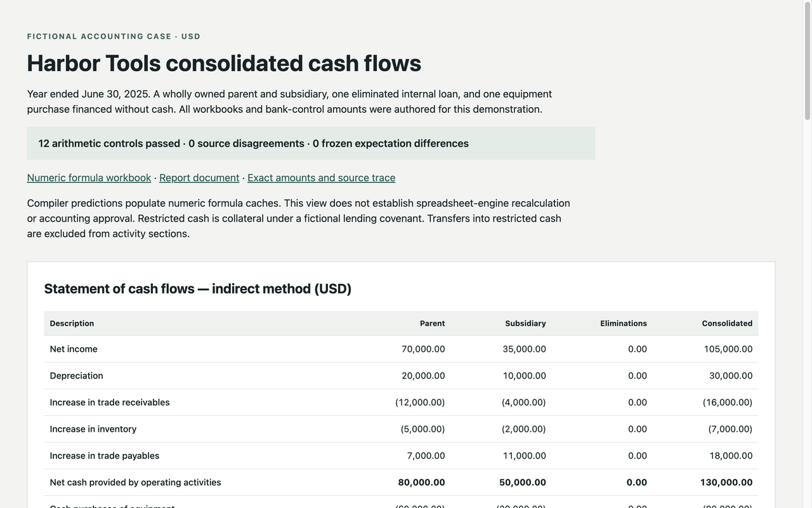

# Cash-flow reporting from retained source workbooks

Generate a consolidated indirect-method cash-flow statement, supporting schedules,
an editable formula workbook, and a report document from three fictional source
workbooks. Every reported amount traces to exact source coordinates and hashes.
The case is a portfolio demonstration; it does not claim prior corporate filing
ownership, a complete financial statement set, or accounting approval.



## Run the worked example

Requires Python 3.11 or later and Rust 1.95.0. Rust 1.95.0 is the tested floor;
compatibility with older Rust releases is not claimed. Install dependencies once:

```bash
python3 -m venv .venv
.venv/bin/python -m pip install -r requirements.txt
```

From a fresh checkout, one command builds the compiler and generates the report:

```bash
make demo
```

Open `output/index.html`, `output/report.xlsx` or `output/report.docx`. Exact
amounts, formulas, source hashes, caption anchors and source-cell dependencies
are retained in `output/report-plan.json`. The artifact receipt binds the
manifest, plan, compiler, builder and Office file hashes. `output/review.json`
retains the accounting-control and source-reconciliation results.

Report generations are create-only: an existing nonempty output directory is
refused before compilation. For another generation, choose a fresh directory:

```bash
.venv/bin/python scripts/demo.py --out output/second-generation
```

## What the case demonstrates

Harbor Tools owns Harbor Parts for the entire year ended June 30, 2025. The
parent/subsidiary columns are consolidation support; the consolidated column
is the reporting result. Amounts are actual USD, unscaled.

| Cash-flow activity | Parent | Subsidiary | Elimination | Consolidated |
|---|---:|---:|---:|---:|
| Operating | 80,000 | 50,000 | 0 | 130,000 |
| Investing | (80,000) | (20,000) | 20,000 | (80,000) |
| Financing | 25,000 | 15,000 | (20,000) | 20,000 |
| Increase in cash and restricted cash | 25,000 | 45,000 | 0 | 70,000 |

The $20,000 parent loan and subsidiary borrowing disappear from consolidated
investing and financing activity. A $30,000 equipment purchase paid directly by
issuing a seller note appears in supplemental noncash disclosures and debt and
equipment rollforwards. It is excluded from cash capex and borrowing proceeds.

Beginning cash and restricted cash of $150,000 plus $70,000 of cash flows equals
$220,000 ending cash and restricted cash. Unrestricted cash rises from $135,000
to $185,000; restricted cash rises from $15,000 to $35,000. The $20,000 transfer
into restricted cash is excluded from operating, investing and financing activity.
The [accounting memo](docs/accounting-memo.md) states the policy assumptions,
classification reasoning, current-source references and limitations.

## Useful failures

`make test` runs the inherited exact-decimal/compiler tests and the corporate
case tests. The adverse cases exercise omitted entities, duplicate source IDs,
duplicated cash movements, incorrect period/entity/caption/hash, missing
intercompany eliminations, and noncash equipment included in both cash activity
sections even when the total cash bridge still ties.

A one-cent ledger-versus-bank-control disagreement remains visible in a numeric
report row and in JSON. Arithmetic admission and source reconciliation are
separate: a disagreement does not become a plug or an enlarged tolerance. The
demo retains the report and returns exit code 1 when source reconciliations or
the frozen expected amounts disagree. Invalid inputs or failed arithmetic
controls return exit code 2 before Office construction.

## Calculation and source boundaries

The Rust compiler uses exact decimal arithmetic. Generated XLSX formulas remain
numeric, unscaled and unrounded. Number formats own spreadsheet presentation.
Their numeric caches contain **same-generation compiler predictions**, so a
viewer can read amounts immediately. These are not evidence of spreadsheet-engine
recalculation; the workbook requests full recalculation when opened. DOCX and
HTML show those same admitted amounts and are snapshots, not live links.

Source workbooks containing formulas must already have usable cached numeric
values. The compiler preserves their formula text but does not recalculate an
external Excel workbook. Accounting mappings and policies are explicit case
assumptions, not inferred from arithmetic. A person must review source
sufficiency and classification before relying on a real report.

All case inputs, including the separate bank-control input, are authored
fictional data. The bank control is not a real bank confirmation or an
independently obtained external audit procedure. `examples/harbor/expected.json`
contains hand-authored expected values, separate from statement expressions.
`make fixtures` is an explicit maintenance command that rewrites source
workbooks/manifest from `source-data.json`; it never updates expected amounts
and is deliberately excluded from `make demo` and CI.

## Reused work and rights

This extracts the existing reporting compiler and local Office builder from
Dave Bettner's private implementation, then adds an original corporate case,
its explicit policies, adversarial cases and a local review page.
[SOURCE-PROVENANCE.json](SOURCE-PROVENANCE.json) records pinned source and public
extraction hashes. Native service adapters and private workpapers are excluded.

Copyright 2026 Dave Bettner. All rights reserved. No open-source license is
granted for this repository. Dependency licenses remain their owners' licenses;
see [NOTICES.md](NOTICES.md). Public visibility alone is not a license grant.

This project complements the [Accounting Evidence Workbench](https://github.com/dbett4/accounting-evidence-workbench)
and [Accounting Acceptance Lab](https://github.com/dbett4/accounting-acceptance-lab).
They remain separate runnable tools; no integrated approval authority is claimed.
